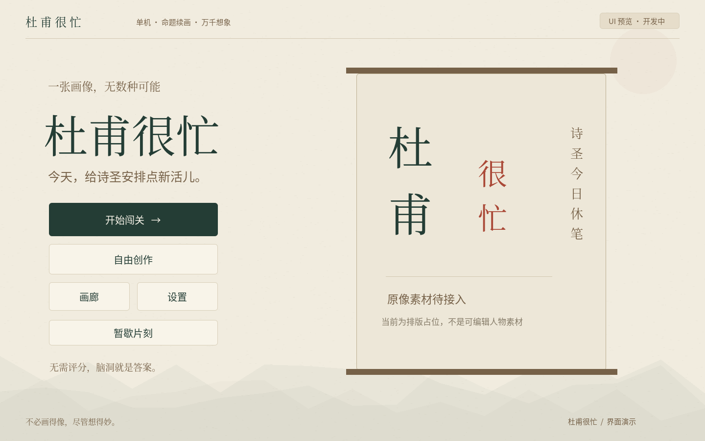
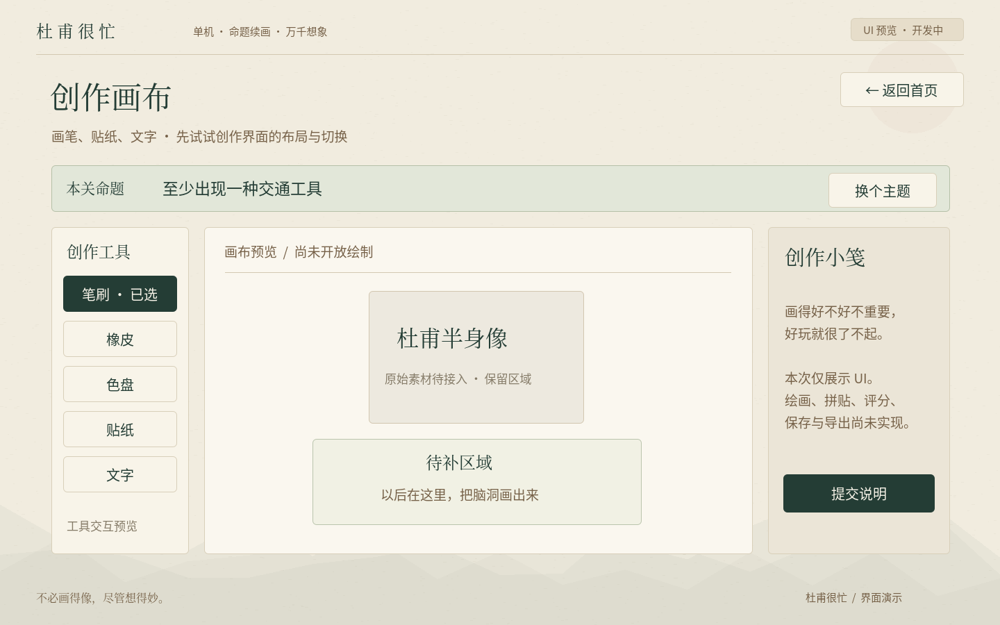

# DuFuIsBusy · 杜甫很忙

基于 Godot **4.7.2 stable**、Compatibility 渲染器的可点击中文 UI Demo。以纸张、墨绿、棕褐、朱红重建真实 `Control` 按钮、面板和统一 `Theme`，没有使用整页截图。

## 当前可体验

- 首页 → 四类命题画卷 → 创作画布，支持返回和切换主题。
- 自由创作入口、工具选择、贴纸分类目录和功能说明弹窗。
- 「我的作品 / 灵感画廊」切换、六项文字构图示例。
- 音量、音效、音乐和画质**偏好**本地存储；重启读取；恢复默认前确认。
- Escape 关闭弹窗或回首页。「暂歇片刻」解释关闭网页标签页的方式。

**绘画、贴纸放置、文字编辑、评分、保存作品、导出都未实现。** 音频不存在，音量和画质仅保存偏好，不伪装生效。个人画廊为空，不会伪造存档。

## 原型与素材状态

已读取上传 PPT 五页的文本结构和策划案。Library 五份附件在本云端工作区传输失败，按规定的一次重试仍失败，故**未完成原型像素核对及原始素材接入**。当前是独立可验收的界面骨架，不能宣称是 PPT 的最终视觉复刻。

首页原像、画布人物和画廊成品图均明确标为占位；画廊展示的是文字构图示例。没有使用第三方 IP 场景，也没有把合成成品图当作分层可编辑素材。纸张纹理和远山是项目代码绘制的简单装饰。

## 本地运行与导出

使用 Godot 4.7.2 和同版官方导出模板：

```sh
godot --editor --path .
godot --headless --editor --import --quit
mkdir -p build/web
godot --headless --export-release Web build/web/index.html
python3 -m http.server 8080 --directory build/web
```

Web 使用单线程，关闭 PWA，无 GDExtension、Wwise、后端、AI 或付费服务。构建产物不进入 git。基准画布 1440×900，窗口改变时等比缩放并保留全部控件；优先桌面或横屏体验，竖屏目前没有重排布局。

## GitHub Pages

`.github/workflows/web.yml` 在 PR 中构建检查，在 `master` 推送或手动触发后发布成功构建。构建只读仓库；部署 job 仅有 `pages: write` 与 `id-token: write`。不需要 PAT。

首次启用：仓库 **Settings → Pages → Build and deployment → Source → GitHub Actions**。随后在 Actions 重新运行 `Godot Web Preview`。

预期地址：<https://arino09.github.io/DuFuIsBusy/>。发布状态以 Actions 和实际公开页面为准。

## 验证与截图

见 [验证报告](docs/validation.md)。截图来自 Godot 原生渲染与真实鼠标输入，不是 HTML 模拟或浏览器验收截图。




字体来自环境安装的 Noto CJK 简体中文版本，按本 Demo 字符集子集化；OFL 许可证及来源保存在 `assets/fonts/LICENSE.txt`。后续新增文字时应重新生成字体子集。
