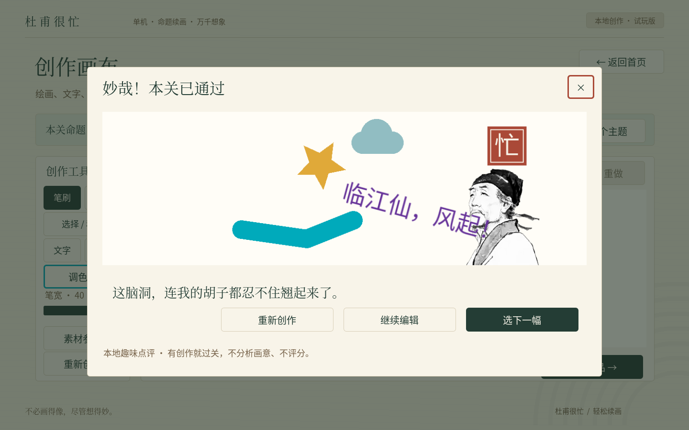

# DuFuIsBusy · 杜甫很忙

Godot **4.7.2 stable / Compatibility** 的中文轻松创作试玩版。真实 Control 与统一 Theme，原创代码纸纹、控件和贴纸，人物来自用户授权 ZIP。

[打开 Web 试玩](https://arino09.github.io/DuFuIsBusy/) · [验证记录](docs/validation.md) · [素材来源](docs/assets.md)

## 可以体验

- 四类命题或自由创作；鼠标、单指绘画，12 种预设颜色、自定义六位 RGB 色号、4–56 像素笔宽及真正擦除。
- 添加及编辑文字：最多 24 字、16–64 字号、自定义颜色。完整 Noto Sans CJK SC 字体支持用户输入中文；不支持的字形明确提示。
- 添加原创星星、祥云、忙字印章。切到「选择 / 移动」后点选或拖动，可缩放、旋转、删除。杜甫也可自由移动、缩放和旋转。
- 画笔与对象操作分离；统一 20 步撤销/重做，各命题跨页面保留。单次拖动为一步；对象始终约束在画布内。
- 提交实际合成人物、笔迹、文字和贴纸的作品图；不含选框。写字、贴纸、绘画或调整杜甫都能过关，无严格评分，无在线 AI。
- 继续编辑、重新创作或换命题；重复提交复用当前版本。画廊示例筛选、源素材参考及本地设置仍可使用。

**画卷仅保留于本次打开期间，刷新或关闭即丢失。保存画作留到下一阶段；本提交没有作品保存、下载、导出或永久画廊。** 最多 24 个文字/贴纸对象；杜甫不删除。原素材目录中的白底拼图与合成示例仍不可分层编辑。没有音频，音频和画质选项只保存偏好。

## 操作

- 画笔/橡皮模式只修改笔迹；「选择 / 移动」模式只操作对象。
- 点击空白、上方「取消」或 Escape 可取消选择。选中文字后点击「编辑」。
- 「缩小/放大」按步调整比例，「左转/右转」每次 15 度。鼠标和触摸均使用相同工具栏。
- 拖动越界、失焦或窗口缩放会结束本次操作；边界约束会让对象保持在画布内。
- 调色盘支持直接选择色块和输入 RGB 色号，例如 `3A9D8F`。新文字默认使用当前画笔颜色。

## 运行与验证

```sh
godot --editor --path .
godot --headless --editor --import --quit
godot --headless --path . --script tests/drawing_test.gd
mkdir -p build/web
godot --headless --export-release Web build/web/index.html
python3 tests/browser_tools.py
python3 tests/browser_drawing.py
python3 tests/browser_text_desktop.py
```

浏览器测试需要 Chromium 和 Playwright；默认启用浏览器沙箱。导出为单线程 Web，关闭 PWA。启用 Godot Web 虚拟键盘支持触摸文字输入。基准 1440×900 等比缩放，推荐桌面或横屏；竖屏控件较小，没有专用手机布局。真实手机键盘仍需真机复核。

Actions 在 PR 构建并执行像素与对象测试，master 推送后部署 Pages，也可手动触发。沿用最小权限、固定版本和官方 SHA-512 校验，无新凭据、在线 AI、后端或付费服务。`build/`、测试、文档和工具不会打入游戏资源包。




字体 OFL 许可见 `assets/fonts/LICENSE.txt`。新增 UI 文案后运行 `tools/subset-fonts.py`；完整用户输入字体的提取脚本为 `tools/copy-creative-font.py`。
