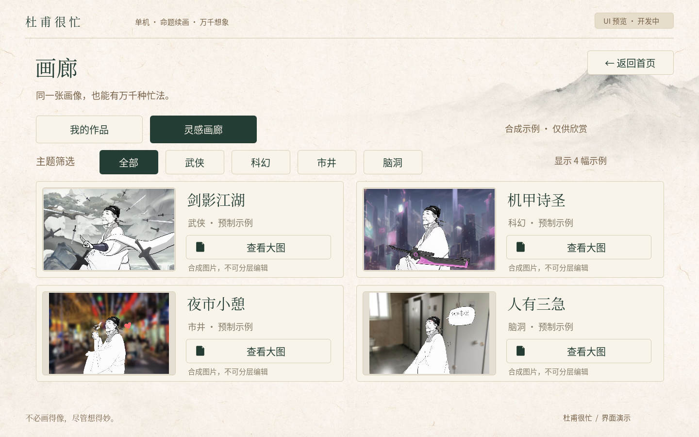

# DuFuIsBusy · 杜甫很忙

基于 **Godot 4.7.2 stable / Compatibility** 的可点击中文 UI Demo。重用用户提供的宣纸、人物、SVG 图标和示例素材，以真实 `Control` 和统一 `Theme` 重建五页界面，不使用整页截图。

[打开 Web 预览](https://arino09.github.io/DuFuIsBusy/) · [验证记录与截图](docs/validation.md) · [素材来源与边界](docs/assets.md)

## 可以体验

- 首页、四类命题画卷、创作画布、双页签画廊、设置之间真实导航与返回。
- 四主题配色和命题切换；更大的画布、可收起说明、明确禁用的撤销/重做。
- 贴纸目录、武器原始拼图及两张场景参考大图。
- 四张真实合成示例，按武侠、科幻、市井和脑洞筛选、查看大图；「我的作品」保留空态。
- 音量、音效、音乐、画质偏好保存在本机；Web 使用同步 localStorage，原生使用 ConfigFile。刷新/重启可恢复，重置前确认。
- Escape 关闭弹窗或返回首页；网页「暂歇片刻」提示用户自行关闭标签页。

**绘画、贴纸放置、文字编辑、评分、作品保存和导出尚未实现。** 画布与弹窗明确标为 UI 预览；预制成品不是用户作品或可编辑图层。没有音频，音量和画质仅保存偏好，不伪装生效。

## 运行与导出

安装 Godot 4.7.2 与同版官方导出模板：

```sh
godot --editor --path .
godot --headless --editor --import --quit
mkdir -p build/web
godot --headless --export-release Web build/web/index.html
python3 -m http.server 8080 --directory build/web
```

Web 单线程，PWA 关闭，无 Wwise、GDExtension、AI、后端或付费服务。构建产物不进入 git。基准画布为 1440×900，等比缩放保留全部控件；推荐桌面或横屏，竖屏尚无专用布局。

`.github/workflows/web.yml` 在 PR 中构建检查，在 master 推送或手动触发后部署 Pages。构建 job 只读仓库；部署 job 仅有 Pages 写入和 OIDC 权限，不使用 PAT。工具链下载使用官方 SHA-512 清单校验。

## 预览截图




字体许可保存在 `assets/fonts/LICENSE.txt`。新增界面文字时，运行 `tools/subset-fonts.py` 更新字体子集。
